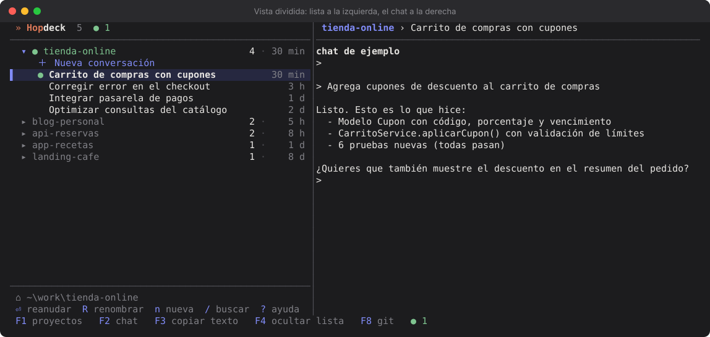
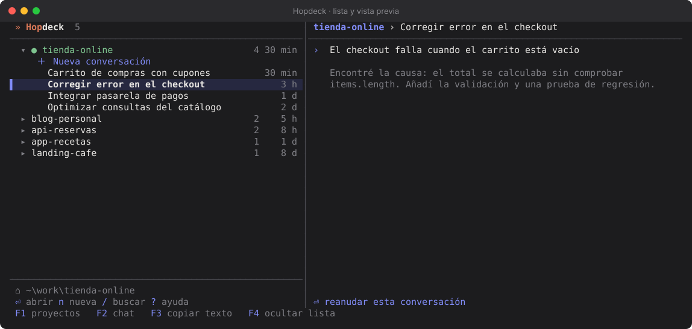
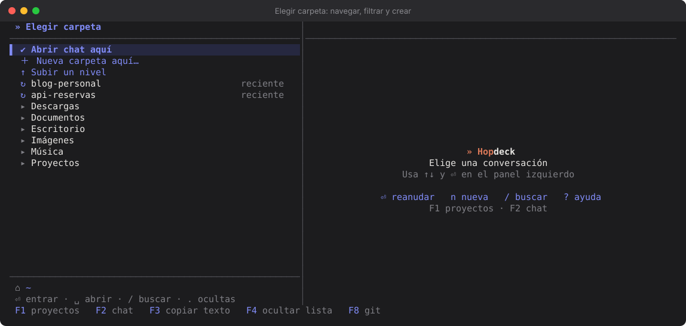
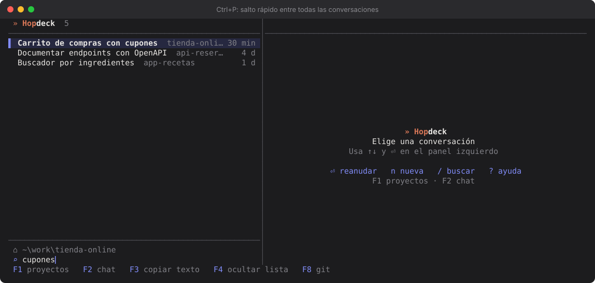

<p align="center">
  <picture>
    <source media="(prefers-color-scheme: dark)" srcset="docs/logo-dark.svg">
    
  </picture>
</p>

<p align="center"><b>Hop between your Claude Code projects and conversations without leaving the terminal.</b></p>

[Español](README.md) · **English**

[](https://www.npmjs.com/package/hopdeck)
[](https://github.com/fabriciodev26/hopdeck/actions/workflows/ci.yml)
[](LICENSE)
[](package.json)

Type `claude` in your terminal and **pick which project and conversation to continue**, without leaving and without `cd`.
The project list stays on the left and the conversation on the right.



> **Independent community project.** Not affiliated with, endorsed or sponsored by Anthropic.
> "Claude" and "Claude Code" are trademarks of Anthropic, PBC. Hopdeck only reads the local history that Claude Code already keeps on your machine and launches the `claude` command you have installed.

## Contents

[Why](#why) · [Install](#install) · [Getting started](#getting-started) · [Keys](#keys) · [Features](#features) · [Compatibility](#compatibility) · [Configuration](#configuration) · [Privacy](#privacy) · [Troubleshooting](#troubleshooting) · [Contributing and license](#contributing-and-license)

## Why

Claude Code stores each conversation tied to a folder. To resume one you have to remember the folder, `cd` into it and run `claude --resume`.
Hopdeck shows **all your projects and conversations on one screen**, with previews, search, and several chats open at once.

## Install

**You need**

- [Node.js](https://nodejs.org) 22 or newer.
- [Claude Code](https://claude.com/claude-code) installed (the `claude` command must work in your terminal).
- A terminal with color. On Windows, **Windows Terminal** is recommended.

**Install**

```bash
npm install -g hopdeck
hopdeck
```

Done. You can also try it without installing: `npx hopdeck`.

**The first time** you open it, Hopdeck asks whether typing `claude` should open it. If you say yes, it adds a small `claude` function to your shell profile (bash, zsh, fish or PowerShell), after saving a **backup** of the profile (it works in a new terminal):

- `claude` alone → opens Hopdeck.
- `claude <any argument>` (`-p`, `--resume`, `--model`…) → works exactly as usual.

You can say no and always use `hopdeck`. If you change your mind: `hopdeck install`.

**Remove it:** `hopdeck uninstall`. To skip it once: `HOPDECK_SKIP=1 claude`.

**Something wrong?** Run `hopdeck doctor`: it checks your setup and tells you how to fix whatever is missing.

## Getting started



1. Pick a project with `↑` `↓` or by hovering it with the mouse.
2. `→` or `⏎` expands its conversations. While you move, the right pane shows **a preview**.
3. `⏎` on a conversation **resumes** it. `＋ New conversation` (or `n`) starts a new one in that project.
4. `F1` goes back to the list and `F2` to the chat. Opened conversations **stay alive** while you switch (marked with `●`).
5. `q` closes Hopdeck. Your history stays saved and can be resumed.

## Keys

| Key | Action |
|---|---|
| `↑` `↓` (or `j` `k`) | Move through the list |
| `→` / `⏎` | Expand the project / resume the conversation |
| `←` / `esc` | Back |
| `n` | New conversation in the selected project |
| `o` | **Pick a folder** and open a chat there ([see below](#pick-a-folder)) |
| `/` | Search by project or title (`Tab` also searches inside the text) |
| `Ctrl+P` / `F5` | **Quick jump** across every conversation of every project |
| `F1` / `F2` | Focus the list / the chat |
| `c` / `F6` | Close the open chat |
| `i` / `F7` | View the conversation's images |
| `p` | Pin the project on top (★) |
| `x` / `H` | Hide the project / show hidden and archived |
| `R` | Rename the conversation |
| `a` | Archive / unarchive the conversation (nothing is deleted) |
| `[` `]` | Narrow / widen the list |
| `F3` | Turn the mouse off/on (to select text with the terminal) |
| `F4` | Hide/show the list to give the chat the full width |
| `r` · `?` · `q` | Reload · help · quit |

Every text box supports a cursor: `←` `→`, `Home`/`End`, `Delete`, and `Ctrl+U` to clear up to the start.

## Features

### Hover preview

With no chat open, the right pane shows the last messages of the selected conversation. With the mouse you only need to **hover** the list, no click needed.

### Pick a folder



Press `o` to open a chat in **any folder**, with or without history, without typing paths:

| Key | Action |
|---|---|
| `↑` `↓` | Move |
| `⏎` / `→` | **Enter** the highlighted folder (to keep browsing) |
| `space` | **Open a chat** in the highlighted folder, without entering |
| `✔ Open chat here` | Open a chat in the folder you are looking at |
| `←` | Go up one level (on Windows, from a drive root it lists the drives) |
| `/` | Filter folders by typing |
| `.` | Show / hide hidden folders |
| `~` | Back to your home folder |
| `n` or `＋ New folder here…` | Create a folder by typing just its name (asks for a second `⏎` to confirm) |

It always starts at `~`. Recently used folders appear on top (`↻ recent`).

### Quick jump



`Ctrl+P` searches **every** conversation of **every** project (title, project and first message). `⏎` opens it directly.

### Images in the chat

![Floating box with the image when hovering [Image #1]](docs/screenshots/04-hover-imagen.svg)

- If a chat shows `[Image #3]` (an image you already sent), **hover it** and a box shows that image without covering the rest of the chat.
- `i` / `F7` opens a **gallery** with all the conversation's images (`← →` navigate, `o` opens it in the system viewer, `Esc` closes).
- An image you just pasted and have not sent yet **cannot** be shown: it is not in the history yet.

### Chat status

- A new chat shows up in the list immediately (`● New conversation`), even if the folder has no history yet.
- Each chat shows its status: an indicator while Claude works, `●` when waiting and `✔` when it finished while you were looking elsewhere. When one finishes you get a bell and a desktop notification (turn it off in the settings).
- When you reopen Hopdeck it remembers the project and conversation you were on.

### Scroll and copy

- **Scroll** the chat with the mouse wheel or `PgUp` / `PgDn`; `End` or typing returns you to the bottom.
- **Copy:** drag with the mouse over the chat and the text goes to the clipboard. `F3` turns the mouse off if you prefer terminal selection (or use `Shift`+drag).

### More

- The project's **git branch** is shown and the list refreshes itself.
- Available in **Spanish and English** (follows the system language).

## Commands

| Command | What it does |
|---|---|
| `hopdeck` | Opens Hopdeck |
| `hopdeck install` / `hopdeck uninstall` | Installs or removes the shortcut so that `claude` opens Hopdeck |
| `hopdeck doctor` | Checks your setup and tells you how to fix whatever is missing |
| `hopdeck --list` | Lists the projects as plain text |
| `hopdeck --version` | Shows the version |
| `hopdeck --model opus` | Anything starting with `-` is passed to `claude` when opening chats |

Each command has **one single form**. Any other word, or a variant such as `--uninstall`, `desinstalar` or `unistall`, gives an error that suggests the right command (`uninstall`) and does not open Hopdeck.

## Compatibility

| System | Works with | Notes |
|---|---|---|
| **Windows** | PowerShell, CMD, Windows Terminal | All features. This is where it has been tested the most. |
| **macOS / Linux** | Any terminal with color | With `tmux` installed it uses tmux panes (the list responds to the wheel and clicks, but no hover preview or chat images); without `tmux`, it uses a built-in terminal with every feature. |
| **WSL** | Same as Linux | Reads WSL's history, which is separate from Windows' (see [troubleshooting](#troubleshooting)). |

## Configuration

You almost never need to change anything. The most useful options:

| Environment variable | Effect |
|---|---|
| `HOPDECK_LANG` | `es` or `en` (default: system language) |
| `HOPDECK_THEME` | `light` for light backgrounds |
| `NO_COLOR` | Disable colors |
| `CLAUDE_CONFIG_DIR` | Claude Code folder, if it is not `~/.claude` |
| `HOPDECK_SKIP=1` | Skip Hopdeck once: `HOPDECK_SKIP=1 claude` |

Your preferences (pinned and hidden projects, list width, mouse…) are saved automatically in `~/.hopdeck.json`.

<details>
<summary>Advanced options</summary>

Keys in `~/.hopdeck.json` you can edit by hand:

| Key | Purpose | Default |
|---|---|---|
| `notify` | Desktop notification when a chat finishes | `true` |
| `mouse` | Mouse enabled (`F3` toggles) | `true` |
| `sidebar` | List width (`[` and `]` adjust it) | automatic |
| `maxImages` | Max images per conversation in the gallery | `200` |
| `previewMsgs` | Messages shown in the preview | `12` |

Other variables: `HOPDECK_EMBED=1` forces the built-in terminal, `HOPDECK_NOTMUX=1` avoids tmux and `HOPDECK_NOEMBED=1` disables it; `HOPDECK_CONFIG` and `HOPDECK_CACHE` change the paths of your preferences and the cache.

</details>

## Privacy

- **Nothing is sent to the internet.** No telemetry, no analytics, no network requests. Everything happens on your machine.
- It reads your local Claude Code history and launches the `claude` you already have. It does not touch your session or your credentials.
- It only writes its preferences and cache (in your home folder), the `hopdeck install` block in your shell profile and, if you rename a conversation, that conversation's title.

More details, and how to report a security problem: [SECURITY.md](SECURITY.md).

## Troubleshooting

Always start with `hopdeck doctor`.

**`Ctrl+V` does not paste images (Windows Terminal).** Windows Terminal keeps `Ctrl+V` for text paste. Options:
- Use **`Alt+V`**, which pastes the image into Claude with no setup.
- Or remap `Ctrl+V`: in *Settings → Open JSON file*, inside `"actions"`, add
  `{ "command": { "action": "sendInput", "input": "\u001bv" }, "keys": "ctrl+v" }`
  and remove `ctrl+v` from the paste action. Text still pastes with `Ctrl+Shift+V`.

**I can't see a conversation I just had.** Hopdeck reads the history of the system it runs on. If you use Claude Code in **both WSL and Windows**, each has its own history, and the Windows Hopdeck does not see what you did in WSL (or vice versa). A new chat shows up in the list right away, but it only links to its conversation once Claude saves it (after your first message).

**The mouse wheel doesn't scroll the chat.** It works with the chat history and with Claude in full screen. If it does not respond, use `PgUp` / `PgDn`.

**I can't select text with the mouse.** Press `F3` to turn Hopdeck's mouse off, or hold `Shift` while dragging.

**I want `claude` back to normal.** `hopdeck uninstall`, or `HOPDECK_SKIP=1 claude` to skip it once.

**It looks wrong in my terminal.** Try `HOPDECK_THEME=light` (light background) or `NO_COLOR=1`.

## Contributing and license

Want to help or see how it is built? See [CONTRIBUTING.md](CONTRIBUTING.md). Change history: [CHANGELOG.md](CHANGELOG.md) (Spanish).

[MIT](LICENSE) © 2026 fabriciodev26. Dependencies keep their own licenses ([details](THIRD_PARTY_NOTICES.md)).
