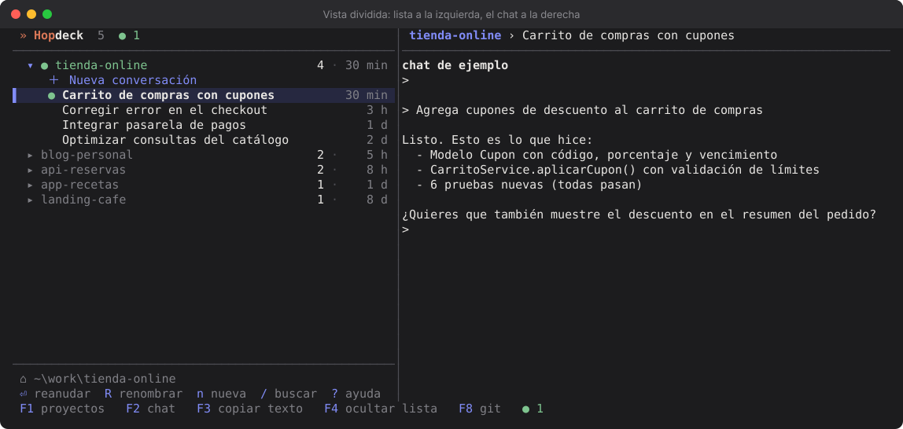
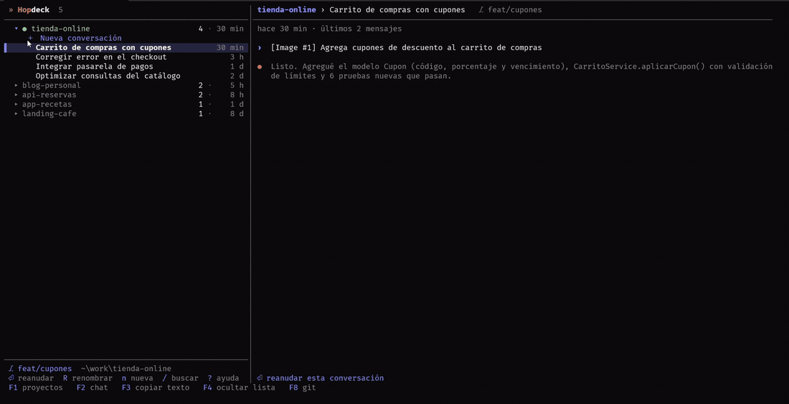
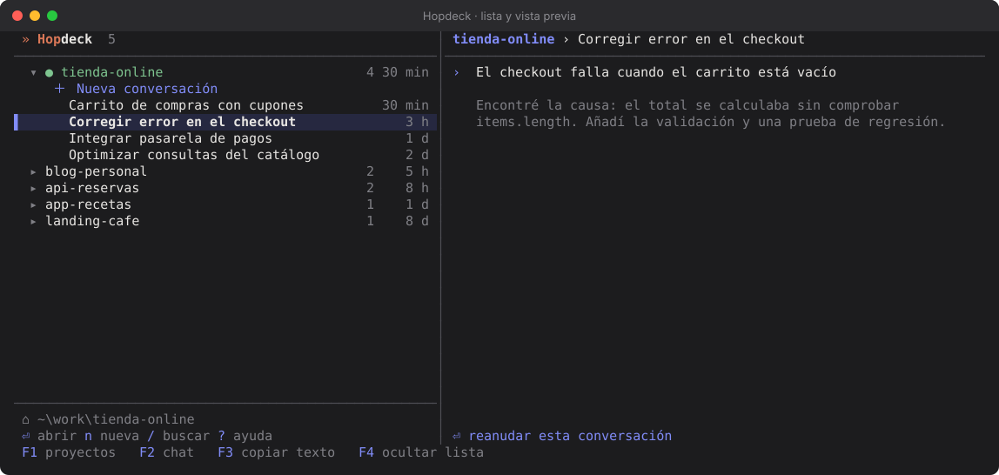
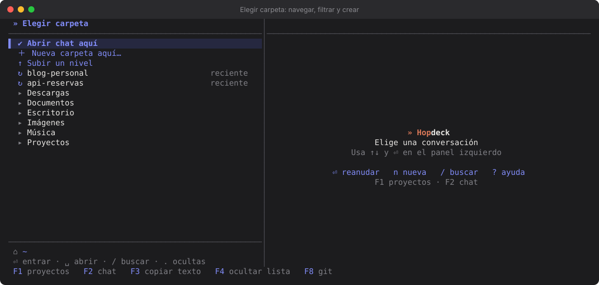
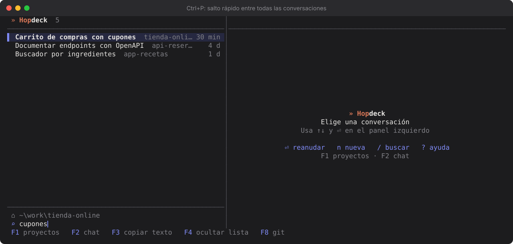
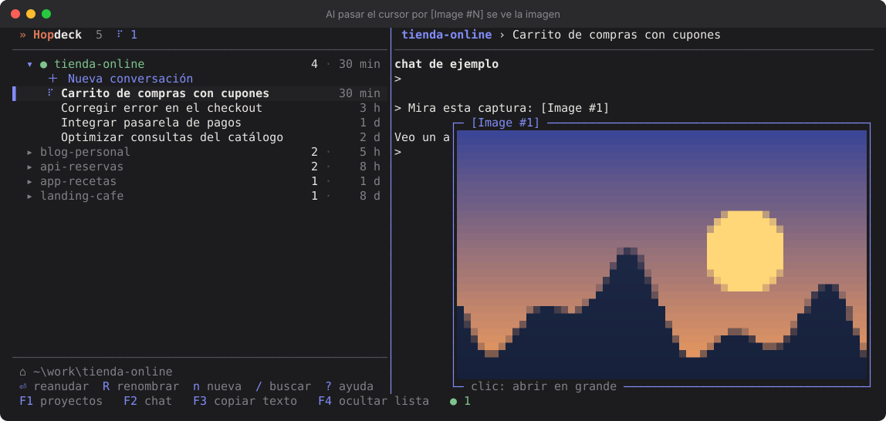
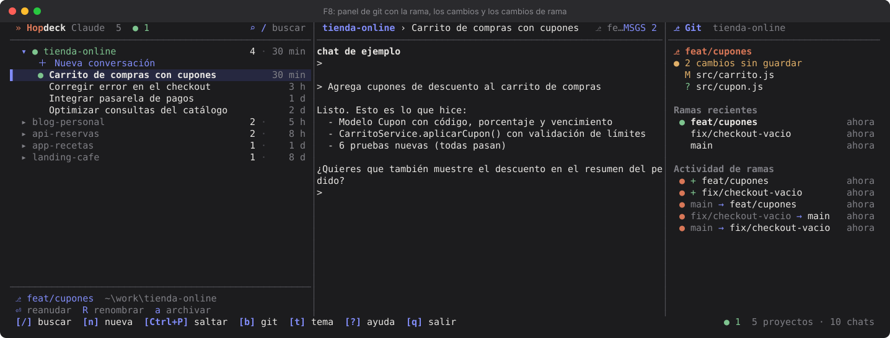

<p align="center">
  <picture>
    <source media="(prefers-color-scheme: dark)" srcset="docs/logo-dark.svg">
    
  </picture>
</p>

<p align="center"></p>

<p align="center"><b>Salta entre tus proyectos y conversaciones de Claude Code o Codex, sin salir de la terminal.</b></p>

**Español** · [English](README.en.md)

[](https://www.npmjs.com/package/hopdeck)
[](https://github.com/fabriciodev26/hopdeck/actions/workflows/ci.yml)
[](LICENSE)
[](package.json)

Escribe `claude` en tu terminal y **elige en qué proyecto y conversación seguir**, sin salir y sin hacer `cd`.
La lista de proyectos queda a la izquierda y la conversación a la derecha.

### Claude y Codex

Con los atajos instalados, `claude` abre Hopdeck con Claude Code y `codex` lo abre con Codex CLI. Cada modo muestra su propio historial y recuerda sus propias preferencias. Los comandos con argumentos (`claude -p ...`, `codex exec ...`, `codex resume ...`) siguen ejecutando directamente su CLI.

El modo Codex muestra exclusivamente conversaciones identificadas como creadas con Codex CLI, la aplicación de Codex o su extensión. Excluye las sesiones de Work (`codex_work_desktop`) y las de origen desconocido, aunque compartan carpeta con un proyecto de Codex. Los nombres de las carpetas no se usan para decidir el origen.

```bash
hopdeck --provider claude
hopdeck --provider codex
hopdeck shortcut on
```

Si ya tenías el atajo de Claude, ejecuta otra vez `hopdeck shortcut on` y abre una terminal nueva para añadir el de Codex. Desde una copia del repositorio, usa primero `npm link` para actualizar el comando global con tu código local.

**Modo Codex:** lista proyectos y conversaciones, vista previa, imágenes, búsqueda por proyecto/título/primer mensaje, chats nuevos y reanudados, varios chats abiertos y panel de Git. Necesita `codex` instalado y con soporte para `codex app-server`. Hopdeck consulta el historial mediante su API local y reanuda con `codex resume <ID>`; no modifica las bases de datos de Codex. Los nombres personalizados y archivados se guardan solo en Hopdeck (`~/.hopdeck-codex.json`). Las estadísticas y la búsqueda en el contenido completo quedan disponibles en el modo Claude; los indicadores de actividad de Codex son básicos y dependen del texto de su terminal.

En Codex, `i` / `F7` abre la galería y las marcas `[Image #N]` permiten previsualizar con el cursor o abrir con clic. Se leen los adjuntos guardados en el historial y los archivos locales que sigan existiendo. Las URL remotas y los adjuntos que Codex solo identifica mediante `fileId` no se descargan. Un archivo borrado o una imagen aún sin enviar no tiene vista previa.

<picture>
  <source media="(prefers-color-scheme: light)" srcset="docs/screenshots/02-vista-dividida-light.svg">
  
</picture>

<p align="center"></p>

> **Proyecto independiente de la comunidad.** No está afiliado, respaldado ni patrocinado por Anthropic ni OpenAI.
> Hopdeck lee el historial local de Claude Code o consulta el historial mediante Codex CLI y lanza el comando `claude` o `codex` que tengas instalado. Cada CLI conserva su autenticación y sus conexiones habituales.

## Índice

[Por qué](#por-qué) · [Instalación](#instalación) · [Primeros pasos](#primeros-pasos) · [Teclas](#teclas) · [Funciones](#funciones) · [Compatibilidad](#compatibilidad) · [Configuración](#configuración) · [Privacidad](#privacidad) · [Problemas frecuentes](#problemas-frecuentes) · [Colaborar y licencia](#colaborar-y-licencia)

## Por qué

Claude Code guarda cada conversación ligada a una carpeta. Para retomar una hay que acordarse de en qué carpeta estaba, hacer `cd` y abrir `claude --resume`.
Hopdeck te enseña **todos tus proyectos y conversaciones en una sola pantalla**, con vista previa, búsqueda y varios chats abiertos a la vez.

## Instalación

**Necesitas**

- [Node.js](https://nodejs.org) 22 o superior.
- [Claude Code](https://claude.com/claude-code) o [Codex CLI](https://developers.openai.com/codex/cli) instalado (el comando correspondiente debe funcionar en tu terminal).
- Una terminal con color. En Windows se recomienda **Windows Terminal**.

**Instalar**

```bash
npm install -g hopdeck
hopdeck
```

También puedes instalarlo con pnpm:

```bash
pnpm add -g hopdeck@latest
hopdeck
```

Si pnpm pide configurar su carpeta global, ejecuta `pnpm setup` y abre una terminal nueva. pnpm 12 puede seleccionar la versión anterior durante su espera predeterminada de 24 horas para versiones recién publicadas.

Al abrir cada modo de Hopdeck por primera vez aparece una bienvenida con la versión y los comandos para empezar. Pulsa `Enter` para continuar o `Esc` para omitirla; después no vuelve a aparecer en ese modo. Sigue la pregunta habitual de los atajos. No se muestra con `--version`, `--help`, `--list`, en CI ni con `HOPDECK_NOPROMPT=1`. La instalación sigue siendo `npm install -g hopdeck`, sin opciones adicionales.

Listo. También puedes probarlo sin instalar: `npx hopdeck`.

**La primera vez** que lo abras, Hopdeck te pregunta si quieres que escribir `claude` lo abra. Si dices que sí, añade una pequeña función `claude` a tu perfil de shell (bash, zsh, fish o PowerShell), después de guardar una **copia de seguridad** del perfil (en una terminal nueva ya funciona):

- `claude` solo → abre Hopdeck.
- `claude <cualquier argumento>` (`-p`, `--resume`, `--model`…) → funciona exactamente igual que siempre.

Puedes decir que no y usar siempre `hopdeck`. Si cambias de idea: `hopdeck shortcut on`.

**Quitar solo el atajo:** `hopdeck shortcut off`. **Desinstalar Hopdeck por completo:** `hopdeck uninstall` (pregunta antes; quita el atajo, tus preferencias y la caché, y el programa). Para saltar el atajo una sola vez: `HOPDECK_SKIP=1 claude`.

**¿Algo no va bien?** Ejecuta `hopdeck doctor`: revisa tu instalación y dice cómo arreglar lo que falte.

## Primeros pasos

<picture>
  <source media="(prefers-color-scheme: light)" srcset="docs/screenshots/01-lista-y-vista-previa-light.svg">
  
</picture>

1. Elige un proyecto con `↑` `↓` o pasando el ratón por encima.
2. `→` o `⏎` despliega sus conversaciones. Mientras te mueves, el panel derecho muestra **una vista previa**.
3. `⏎` sobre una conversación la **reanuda**. `＋ Nueva conversación` (o `n`) empieza una nueva en ese proyecto.
4. `F1` vuelve a la lista y `F2` al chat. Las conversaciones abiertas **siguen vivas** mientras cambias de una a otra (llevan un `●`).
5. `q` cierra Hopdeck. El historial queda guardado y se puede reanudar.

## Teclas

| Tecla | Acción |
|---|---|
| `↑` `↓` (o `j` `k`) | Moverte por la lista |
| `→` / `⏎` | Desplegar el proyecto / reanudar la conversación |
| `←` / `esc` | Volver |
| `n` | Nueva conversación en el proyecto seleccionado |
| `o` | **Elegir una carpeta** y abrir un chat ahí ([ver abajo](#elegir-una-carpeta)) |
| `/` | Buscar por proyecto o título (`Tab` busca también dentro del texto) |
| `Ctrl+P` / `F5` | **Salto rápido** entre todas las conversaciones de todos los proyectos |
| `F1` / `F2` | Foco en la lista / en el chat |
| `c` / `F6` | Cerrar el chat abierto |
| `i` / `F7` | Ver las imágenes de la conversación |
| `p` | Fijar el proyecto arriba (★) |
| `x` / `H` | Ocultar el proyecto / mostrar ocultos y archivadas |
| `R` | Renombrar la conversación |
| `a` | Archivar / desarchivar la conversación (no se borra nada) |
| `[` `]` | Estrechar / ensanchar la lista |
| `F3` | Apagar/encender el ratón (para seleccionar texto con el terminal) |
| `F4` | Ocultar/mostrar la lista para dar todo el ancho al chat |
| `F8` · `b` | Mostrar/ocultar el panel de git (tercer panel). `b` funciona con el foco en la lista; en macOS `F8` suele necesitar `Fn` |
| `t` · `F9` | Cambiar entre tema claro y oscuro al instante (se recuerda). También: `hopdeck theme light\|dark\|auto` |
| `r` · `?` · `q` | Recargar · ayuda · salir |

En todas las cajas de texto puedes mover el cursor con `←` `→`, ir al principio/final con `Inicio`/`Fin`, borrar con `Supr` y vaciar hasta el inicio con `Ctrl+U`.

## Funciones

### Vista previa al pasar el cursor

Sin ningún chat abierto, el panel derecho muestra los últimos mensajes de la conversación seleccionada. Con el ratón basta **pasar el cursor** por la lista, sin hacer clic.

En la fila del título, a la derecha, salen las estadísticas de la conversación: `MSGS` (mensajes), `TOK` (tokens: entrada, salida y caché), `TOOLS` (herramientas usadas) y el modelo. Aparecen tanto en la vista previa como con el chat abierto, y si el panel es estrecho se quitan primero los menos importantes. Se calculan en segundo plano la primera vez, y después solo se lee lo que Claude va añadiendo.

### Elegir una carpeta

<picture>
  <source media="(prefers-color-scheme: light)" srcset="docs/screenshots/03-selector-de-carpetas-light.svg">
  
</picture>

Pulsa `o` para abrir un chat en **cualquier carpeta**, tenga o no historial, sin escribir rutas:

| Tecla | Acción |
|---|---|
| `↑` `↓` | Moverte |
| `⏎` / `→` | **Entrar** a la carpeta resaltada (para seguir buscando dentro) |
| `espacio` | **Abrir un chat** en la carpeta resaltada, sin entrar |
| `✔ Abrir chat aquí` | Abrir un chat en la carpeta que estás viendo |
| `←` | Subir un nivel (en Windows, desde la raíz lista las unidades) |
| `/` | Filtrar las carpetas escribiendo |
| `.` | Mostrar / ocultar las carpetas ocultas |
| `~` | Volver a tu carpeta de usuario |
| `n` o `＋ Nueva carpeta aquí…` | Crear una carpeta escribiendo solo el nombre (pide confirmar con un segundo `⏎`) |

Empieza siempre en `~`. Las carpetas que usaste hace poco aparecen arriba (`↻ reciente`).

### Salto rápido

<picture>
  <source media="(prefers-color-scheme: light)" srcset="docs/screenshots/05-salto-rapido-light.svg">
  
</picture>

`Ctrl+P` busca entre **todas** las conversaciones de **todos** los proyectos (título, proyecto y primer mensaje). `⏎` la abre directamente.

### Imágenes del chat

En los chats de Claude y Codex, un clic sobre una URL `http://` o `https://` abre el navegador predeterminado. También reconoce enlaces partidos entre líneas; arrastrar sobre el texto permite seleccionarlo.

<picture>
  <source media="(prefers-color-scheme: light)" srcset="docs/screenshots/04-hover-imagen-light.svg">
  
</picture>

- Si en un chat ves `[Image #3]` (una imagen que ya enviaste), **pasa el cursor por encima** y aparece una vista rápida, sin tapar el resto del chat. En un terminal solo se puede dibujar una versión pequeña (dos píxeles por carácter), así que una captura con texto no se lee: **haz clic sobre la marca** y se abre en grande, a su tamaño real, en el visor de imágenes de tu sistema.
- `i` / `F7` abre una **galería** con todas las imágenes de la conversación (`← →` navegan, `o` la abre en el visor del sistema, `Esc` cierra).
- Una imagen recién pegada y aún sin enviar **no** se puede mostrar: todavía no está en el historial.

### Panel de git

`F8` (o `b` con el foco en la lista) abre un **tercer panel** a la derecha del chat, de solo lectura, con el estado git de la carpeta del chat (o del proyecto seleccionado):

- la **rama actual**, con lo que lleva por delante o por detrás del remoto;
- los **cambios sin guardar** (archivos modificados, nuevos o borrados);
- las **ramas recientes**;
- la **actividad de ramas**: cambios de rama, ramas creadas y merges, tomados del registro (`reflog`) de git. Los de los últimos 10 minutos llevan un punto naranja. Sirve para enterarte de cuándo se creó o cambió de rama, desde Claude o desde donde sea (git no dice quién lo hizo).

<picture>
  <source media="(prefers-color-scheme: light)" srcset="docs/screenshots/06-panel-git-light.svg">
  
</picture>

Se refresca solo cada pocos segundos y no modifica nada en el repositorio. Necesita `git` y una terminal de unas 140 columnas o más (si no cabe, te lo avisa). Solo está en el terminal integrado, no en el modo tmux.

### Estado de los chats

- Un chat nuevo aparece al instante en la lista (`● Nueva conversación`), aunque la carpeta aún no tenga historial.
- Cada chat muestra su estado: un indicador mientras Claude trabaja, `●` cuando espera y `✔` cuando terminó mientras mirabas otro. Al terminar suena la campanilla y sale un aviso de escritorio (se apaga en la configuración).
- Al volver a abrir Hopdeck recuerda el proyecto y la conversación donde estabas.

### Scroll y copiar

- **Scroll** en el chat: rueda del ratón o `PgUp` / `PgDn`; `End` o escribir algo te devuelve al final.
- **Seleccionar y copiar:** arrastra con el ratón sobre el chat para marcar texto; no se copia solo. Cópialo con `Ctrl+C` o con el clic derecho, y quita la selección con `Esc` o haciendo clic en otro sitio. Si arrastras hasta el borde de arriba o de abajo, el chat se desplaza solo y la selección sigue, así que puedes marcar mucho más de lo que cabe en pantalla. Si prefieres el comportamiento anterior (copiar al soltar), pon `"copyOnSelect": true` en `~/.hopdeck.json`. `F3` apaga el ratón si prefieres seleccionar con el terminal (o usa `Shift`+arrastrar).

**Command+C en macOS:** Hopdeck también reconoce `⌘C` sobre su selección cuando la terminal envía la secuencia `ESC [99;9u` (CSI u). El atajo nativo de copiar de la terminal puede interceptarlo; que una terminal soporte CSI u no significa que reenvíe `⌘C` por defecto. Hopdeck no cambia tus atajos ni copia automáticamente al seleccionar.

- **iTerm2:** en un perfil dedicado a Hopdeck, abre **Settings → Profiles → Keys → Key Mappings**, añade `⌘C`, elige **Send Escape Sequence** y escribe `[99;9u` (sin escribir `ESC`). Así el atajo llega a Hopdeck. [Referencia de iTerm2](https://iterm2.com/documentation-preferences-profiles-keys.html).
- **Ghostty:** en una configuración dedicada a Hopdeck, usa `keybind = super+c=csi:99;9u`. Esta asignación sustituye el comando de copia nativo mientras uses esa configuración. [Referencia de acciones de Ghostty](https://ghostty.org/docs/config/keybind/reference).
- **Terminal de Apple, o sin configurar atajos:** pulsa `F3` (o `Fn+F3`) para desactivar el ratón de Hopdeck, selecciona con la propia terminal y usa `⌘C`. Vuelve a pulsar `F3` para recuperar el ratón de Hopdeck. En este modo se copia la selección de la terminal, no la selección interna del chat.

`Ctrl+C` y el clic derecho siguen copiando la selección interna en macOS. Sin selección interna, `Ctrl+C` se envía al chat para interrumpirlo. En Windows y Linux se conservan los atajos actuales.

### Otros detalles

- Se muestra la **rama de git** del proyecto y la lista se refresca sola.
- Disponible en **español e inglés** (sigue el idioma del sistema).

## Comandos

| Comando | Qué hace |
|---|---|
| `hopdeck` | Abre Hopdeck |
| `hopdeck shortcut on` / `hopdeck shortcut off` | Instala o quita el atajo para que `claude` abra Hopdeck |
| `hopdeck theme light` / `dark` / `auto` | Cambia el tema de colores y lo guarda (`hopdeck theme` muestra el actual) |
| `hopdeck mascot` | Dibuja la mascota en el terminal (`--size small\|normal\|large`; `--plain` la dibuja sin colores). También sale en la pantalla de inicio de Hopdeck |
| `hopdeck uninstall` | **Desinstala Hopdeck por completo**: el atajo, tus preferencias y la caché, y el programa. Pregunta antes (sin terminal, usa `--yes`). No toca tu historial de Claude Code |
| `hopdeck doctor` | Revisa tu instalación y dice cómo arreglar lo que falte |
| `hopdeck --list` | Lista los proyectos en texto plano |
| `hopdeck --version` | Muestra la versión |
| `hopdeck --model opus` | Lo que empiece por `-` se pasa a `claude` al abrir chats |

Cada comando tiene **una sola forma**. Cualquier otra palabra, o una variante como `install`, `--uninstall`, `desinstalar` o `unistall`, da un error que sugiere el comando correcto y no abre Hopdeck ni hace nada.

## Compatibilidad

| Sistema | Funciona con | Notas |
|---|---|---|
| **Windows** | PowerShell, CMD, Windows Terminal | Todas las funciones. Es donde más se ha probado. |
| **macOS / Linux** | Cualquier terminal con color | Usa el terminal integrado, con todas las funciones (vista previa al pasar el cursor, imágenes del chat). Si prefieres paneles de `tmux`, lanza `HOPDECK_TMUX=1 hopdeck` (la lista responde a la rueda y al clic, pero sin vista previa al pasar el cursor ni imágenes). |
| **WSL** | Igual que Linux | Lee el historial de WSL, que es distinto del de Windows (ver [problemas frecuentes](#problemas-frecuentes)). |

## Configuración

Casi nunca hace falta tocar nada. Lo más útil:

| Variable de entorno | Efecto |
|---|---|
| `HOPDECK_LANG` | `es` o `en` (por defecto, el idioma del sistema) |
| `HOPDECK_PROVIDER` | `claude` o `codex` (por defecto, `claude`; `--provider` tiene prioridad) |
| `CODEX_HOME` | Carpeta de Codex, si no es `~/.codex` |
| `HOPDECK_THEME` | `light` o `dark`: manda sobre lo guardado con `hopdeck theme` |
| `HOPDECK_SIXEL` | `1` fuerza la imagen real al pasar el cursor por `[Image #N]`, `0` usa siempre bloques (por defecto se detecta) |
| `HOPDECK_BUSY` | `output` marca un chat como «trabajando» con cualquier salida reciente. Por defecto solo cuando Claude muestra «esc to interrupt» |
| `NO_COLOR` | Quita los colores |
| `CLAUDE_CONFIG_DIR` | Carpeta de Claude Code, si no es `~/.claude` |
| `HOPDECK_SKIP=1` | Salta Hopdeck una vez: `HOPDECK_SKIP=1 claude` |

Tus preferencias (proyectos fijados y ocultos, ancho de la lista, ratón…) se guardan solas en `~/.hopdeck.json`.

<details>
<summary>Opciones avanzadas</summary>

Claves de `~/.hopdeck.json` que puedes editar a mano:

| Clave | Para qué sirve | Por defecto |
|---|---|---|
| `notify` | Aviso de escritorio al terminar un chat | `true` |
| `mouse` | Ratón activado (`F3` lo alterna) | `true` |
| `copyOnSelect` | Copiar al portapapeles en cuanto sueltas la selección del chat | `false` |
| `sidebar` | Ancho de la lista (`[` y `]` lo ajustan) | automático |
| `maxImages` | Imágenes máximas por conversación en la galería | `200` |
| `previewMsgs` | Mensajes mostrados en la vista previa | `12` |

Otras variables: `HOPDECK_TMUX=1` usa paneles de tmux en Linux/macOS, `HOPDECK_EMBED=1` fuerza el terminal integrado, `HOPDECK_NOTMUX=1` evita tmux y `HOPDECK_NOEMBED=1` lo desactiva; `HOPDECK_CONFIG` y `HOPDECK_CACHE` cambian las rutas de tus preferencias y de la caché.

</details>

## Privacidad

- **No envía nada a internet.** Sin telemetría, sin analítica, sin peticiones de red. Todo ocurre en tu equipo.
- Lee tu historial local de Claude Code y lanza el `claude` que ya tienes. No toca tu sesión ni tus credenciales.
- Solo escribe sus preferencias y su caché (en tu carpeta de usuario), el bloque de `hopdeck shortcut on` en tu perfil de shell y, si renombras una conversación, el título de esa conversación.

Más detalles, y cómo avisar de un problema de seguridad: [SECURITY.md](SECURITY.md).

## Problemas frecuentes

Empieza siempre por `hopdeck doctor`.

**`Ctrl+V` no pega imágenes (Windows Terminal).** Windows Terminal se queda con `Ctrl+V` para pegar texto. Opciones:
- Usa **`Alt+V`**, que pega la imagen en Claude sin tocar nada.
- O reasigna `Ctrl+V`: en *Configuración → Abrir archivo JSON*, dentro de `"actions"`, añade
  `{ "command": { "action": "sendInput", "input": "\u001bv" }, "keys": "ctrl+v" }`
  y quita `ctrl+v` de la acción de pegar. El texto se sigue pegando con `Ctrl+Shift+V`.

**No veo una conversación que acabo de tener.** Hopdeck lee el historial del sistema donde se ejecuta. Si usas Claude Code en **WSL y en Windows**, cada uno tiene su propio historial, y Hopdeck de Windows no ve lo que hiciste en WSL (ni al revés). Un chat nuevo aparece en la lista enseguida, pero su conversación solo se enlaza cuando Claude la guarda (tras tu primer mensaje).

**La rueda del ratón no mueve el chat.** Funciona con el historial del chat y con Claude en pantalla completa. Si no responde, usa `PgUp` / `PgDn`.

**No puedo seleccionar texto con el ratón.** Pulsa `F3` para apagar el ratón de Hopdeck, o mantén `Shift` mientras arrastras.

**Quiero que `claude` vuelva a ser el de siempre.** `hopdeck shortcut off`, o `HOPDECK_SKIP=1 claude` para saltarlo una vez.

**Se ve mal en mi terminal.** Prueba `hopdeck theme light` (fondo claro) o `NO_COLOR=1`.

## Colaborar y licencia

¿Quieres ayudar o ver cómo está hecho? Mira [CONTRIBUTING.md](CONTRIBUTING.md). Historial de cambios: [CHANGELOG.md](CHANGELOG.md).

[MIT](LICENSE) © 2026 fabriciodev26. Las dependencias conservan sus propias licencias ([detalle](THIRD_PARTY_NOTICES.md)).
